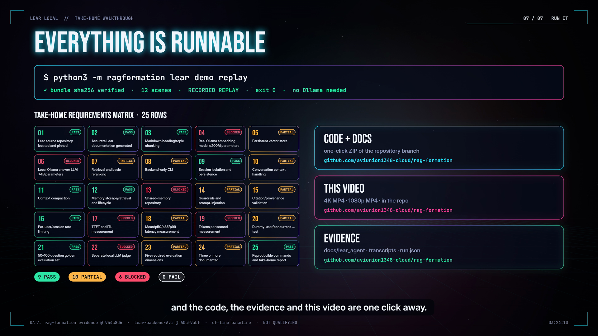

# Submission: Lear Local (take-home)

A backend-only RAG agent that answers questions about the **Lear backend** (`Lear-backend-Avi` @ `60cf9abf`) from documentation generated from that repo. It is CLI only: no GUI, no image or upload features.

> **Honest status.** Everything that does not need a model was built, run and tested here (256 tests). The local-Ollama path is implemented and enforced: loopback only, and the size caps are read from Ollama. It **could not run in the recording sandbox** because Ollama's download host is unreachable from it. The model-dependent rows are therefore **BLOCKED**, and every number below comes from the labelled offline baseline (**NOT QUALIFYING**). Reaching a qualifying run means following the documented runbook on a machine with Ollama (see [final_report.md](docs/lear_agent/final_report.md#run-commands)).

## Direct links

| What | Link |
|---|---|
| 🎬 **Walkthrough film, 4K**: how each part of the brief is met (3 min 37 s, voiceover, music, sound effects, subtitles) | [lear_walkthrough_4k.mp4](https://github.com/aviunion1348-cloud/rag-formation/raw/arena/227b3998-rag-formation/docs/lear_agent/demo_video/lear_walkthrough_4k.mp4) (58.9 MB) |
| 🎬 Same film, 1080p (smaller download) | [lear_walkthrough_1080p.mp4](https://github.com/aviunion1348-cloud/rag-formation/raw/arena/227b3998-rag-formation/docs/lear_agent/demo_video/lear_walkthrough_1080p.mp4) (24.3 MB) |
| 🖥 Terminal demo recording (2 min 14 s, the real CLI) | [lear_demo_terminal.mp4](https://github.com/aviunion1348-cloud/rag-formation/raw/arena/227b3998-rag-formation/docs/lear_agent/demo_video/lear_demo_terminal.mp4) |
| 📦 All the code, one ZIP | [rag-formation (this branch).zip](https://github.com/aviunion1348-cloud/rag-formation/archive/refs/heads/arena/227b3998-rag-formation.zip) |
| 🖼 Screenshots | [walkthrough frame](docs/lear_agent/demo_video/lear_walkthrough_poster.png) · [CLI demo frame](docs/lear_agent/demo_video/lear_demo_poster.png) |



## Run it

No installation is needed: Python 3.9+, standard library only.

```bash
git clone -b arena/227b3998-rag-formation https://github.com/aviunion1348-cloud/rag-formation.git && cd rag-formation
python3 -m ragformation lear demo replay      # recorded walkthrough; bundle sha256 verified; no Ollama needed (exit 0)

# offline baseline (hashing embeddings + extractive answers, labelled NOT QUALIFYING)
python3 -m ragformation lear --backend baseline index rebuild
python3 -m ragformation lear --backend baseline ask 'Does `prash run --dry-run` execute the action?'
```

On a machine with Ollama (the qualifying path; the same commands without `--backend baseline`):

```bash
ollama serve &                                   # stays on 127.0.0.1
ollama pull nomic-embed-text && ollama pull qwen2.5:1.5b && ollama pull llama3.2:1b
python3 -m ragformation lear doctor              # exit 0 only when the models and size caps check out
python3 -m ragformation lear index rebuild --full
python3 -m ragformation lear ask "Which permission modes does the permission engine have?"
python3 -m ragformation lear chat --session demo
python3 -m ragformation lear eval run --suite all --judge on
python3 -m ragformation lear bench --users 1,2,5
```

## Eval summary (paste-ready)

```text
Lear Local: RAG agent for the Lear backend (Lear-backend-Avi @ 60cf9abf). CLI only, local Ollama only.
KB: 19 generated docs, 340/340 claims labelled with evidence, docs verify 11/11 PASS (87 routes = AST of server.py),
    355 heading-based chunks, SQLite vector index + FTS5.
Agent: hybrid retrieval (dense + BM25 -> RRF -> rerank -> MMR); cited answers with Lear source lines;
    sessions + compaction (never grows); user-scoped memory; guardrails (9 live checks: 7 MATCH, 2 documented
    limitations); per-user rate limit.
Eval: 80 golden questions (10 cal / 32 dev / 24 test / 14 holdout), 5 dimensions, 3 evaluate-and-improve rounds.
    Correct (lenient), cal+dev: .452 -> .500 -> .524 -> .548. Test: .417 -> .500. Holdout (used once): .643.
    0 case regressions.
    R1: index hygiene + chunk overlap 40->20. R2: unknown-term scope guard + tight citation line spans.
    R3: no silent fallback + cleaner follow-ups.
Bench (pipeline-only, 1/2/5/10 dummy users): at 10 users 32 req/s, p50 63 ms, p85 429 ms, p99 810 ms.
    Rate limit: 20 requests -> 10 OK / 10 RATE_LIMITED.
Status: Ollama could not be installed in the sandbox, so the LLM, embedder, judge and TTFT/tok-s rows are BLOCKED.
    The numbers above are the labelled offline baseline (NOT QUALIFYING).
    Requirements: 9 PASS / 10 PARTIAL / 6 BLOCKED / 0 FAIL.
Video (4K): https://github.com/aviunion1348-cloud/rag-formation/raw/arena/227b3998-rag-formation/docs/lear_agent/demo_video/lear_walkthrough_4k.mp4
Code: https://github.com/aviunion1348-cloud/rag-formation/archive/refs/heads/arena/227b3998-rag-formation.zip
```

## Evaluate-and-improve rounds

| Round | Commit | What changed | Correct (cal+dev, lenient) | Strict |
|---|---|---|---|---|
| R0 | — | Baseline | .452 | .405 |
| R1 | `e70bec9` | Skip markers keep the generated source map and page lists out of the index; claim labels normalised at index time; chunk overlap 40 → 20 tokens; stale chunks after a chunking change fixed | .500 | .429 |
| R2 | `38bea8c` | Scope guard for unknown named terms; abstention threshold per backend; citation line spans narrowed to the densest run (≤ 40 lines) | .524 | .452 |
| R3 | `fed7dbf` | No silent extractive answer on the Ollama backend (`ERROR`, exit 6); cleaner follow-up expansion | .548 | .476 |

- Test split, scored only at round 0 and after round 3: .417 → .500.
- Holdout, used exactly once: .643.
- The golden set is frozen and checksummed, and there was no tuning on test or holdout. Details are in [round_1_report.md](docs/lear_agent/round_1_report.md), [round_2_report.md](docs/lear_agent/round_2_report.md) and [round_3_report.md](docs/lear_agent/round_3_report.md).
- **Five dimensions** (round 3, 0–4 scale): citations 1.91, groundedness 3.90, answer relevance 2.40, context precision 1.16, context recall 3.39. These are **deterministic proxies**: the separate LLM judge (`llama3.2:1b`) is BLOCKED without Ollama ([judge_rubric.md](docs/lear_agent/judge_rubric.md)).

## Benchmark (pipeline-only, not model latency)

| Dummy users | Mean ms | p50 | p85 | p99 | req/s |
|---|---|---|---|---|---|
| 1 | 33.7 | 34.6 | 36.1 | 36.1 | 27.0 |
| 2 | 70.6 | 67.6 | 85.6 | 85.6 | 26.2 |
| 5 | 105.2 | 62.0 | 236.4 | 420.8 | 30.3 |
| 10 | 179.8 | 63.3 | 428.7 | 810.3 | 32.0 |

The TTFT, ITL and tok/s fields exist in the harness, but with the baseline they measure the extractive stream, not a model. They are reported as BLOCKED for the brief ([benchmark_report.md](docs/lear_agent/benchmark_report.md)).

## Requirements status (25 rows)

| # | Requirement | Status |
|---|---|---|
| 1 | Lear source repository located and pinned | ✅ PASS |
| 2 | Accurate Lear documentation generated | ✅ PASS |
| 3 | Markdown heading/topic chunking | ✅ PASS |
| 4 | Real Ollama embedding model ≤200M parameters | ⛔ BLOCKED |
| 5 | Persistent vector store | 🟡 PARTIAL |
| 6 | Local Ollama answer LLM ≤4B parameters | ⛔ BLOCKED |
| 7 | Retrieval and basic reranking | 🟡 PARTIAL |
| 8 | Backend-only CLI | 🟡 PARTIAL |
| 9 | Session isolation and persistence | ✅ PASS |
| 10 | Conversation context handling | 🟡 PARTIAL |
| 11 | Context compaction | ✅ PASS |
| 12 | Memory storage/retrieval and lifecycle | ✅ PASS |
| 13 | Shared-memory repository connector/import | ⛔ BLOCKED |
| 14 | Guardrails and prompt-injection resistance | 🟡 PARTIAL |
| 15 | Citation/provenance validation | 🟡 PARTIAL |
| 16 | Per-user/session rate limiting | ✅ PASS |
| 17 | TTFT and ITL measurement | ⛔ BLOCKED |
| 18 | Mean/p50/p85/p99 latency measurement | 🟡 PARTIAL |
| 19 | Tokens per second measurement | ⛔ BLOCKED |
| 20 | Dummy-user/concurrent-load test | 🟡 PARTIAL |
| 21 | 50–100 question golden evaluation set | ✅ PASS |
| 22 | Separate local LLM judge | ⛔ BLOCKED |
| 23 | Five required evaluation dimensions | 🟡 PARTIAL |
| 24 | Three or more documented improve/re-evaluate rounds | 🟡 PARTIAL |
| 25 | Reproducible commands and take-home report | ✅ PASS |

**Totals: 9 PASS, 10 PARTIAL, 6 BLOCKED, 0 FAIL.** The evidence for every row is in [requirements_matrix.md](docs/lear_agent/requirements_matrix.md).

## About the walkthrough film

- 3840×2160, 24 fps, H.264 + AAC. Voiceover with synthesized music and sound effects, plus burned-in subtitles.
- Every number on screen is drawn from the repo's evidence files, and the heads-up display reads `offline baseline · NOT QUALIFYING` throughout.
- 3,322 timeline animations, 2,651 of them bound to real repo data, are listed with timings and data sources in [walkthrough_animation_manifest.json](docs/lear_agent/demo_video/walkthrough_animation_manifest.json).
- The build scripts are in [scripts/walkthrough/](scripts/walkthrough/README.md).
