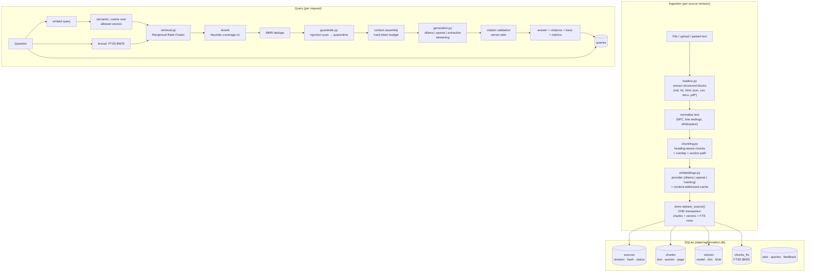

# Architecture

## 1. Shape of the system



\* PDF requires the optional `pypdf` package; OCR is not supported.

## 2. Modules and responsibilities

| Module | Responsibility | Deliberately not its job |
|---|---|---|
| `config.py` | Frozen, validated settings from environment; fingerprints for chunking | Reading secrets from files |
| `loaders.py` | Bytes → structured `Block`s with page numbers, media-type sniffing, size/binary rejection | Chunking, embedding, retrieval |
| `chunking.py` | Heading-aware segmentation, overlap carry, section path, tiny-chunk merge | Knowing about vectors or the store |
| `embeddings.py` | Provider adapters (Ollama, OpenAI-compatible, hashing), retries with jitter, L2 normalisation, embedding cache | Deciding when to reindex |
| `store.py` | SQLite schema, transactional revision swap, BM25 via FTS5, telemetry, integrity report | Business policy (thresholds, abstention) |
| `retrieval.py` | Cosine + BM25 + RRF + rerank + MMR + context budget | Calling a language model |
| `guardrails.py` | Injection detection, credential redaction, citation/URL validation | Being a security boundary for the OS |
| `prompts.py` | The grounding contract sent to the model | Enforcing it (validation does that) |
| `generation.py` | Streaming provider adapters, extractive fallback, TTFT/ITL measurement | Deciding whether evidence is sufficient |
| `engine.py` | Orchestration and policy: ingest lifecycle, abstention threshold, citation validation, telemetry | Parsing or HTTP |
| `api.py` / `cli.py` / `web/` | Surfaces over the same `RAGEngine` | Duplicating logic |
| `evaluation.py` | Golden-set runner, metric computation | Claiming subjective quality |

## 3. Data model (SQLite)

```
sources(source_id PK, title, origin, media_type, byte_size, content_hash,
        revision, status, tenant_id, visibility, tags, warnings, meta,
        created_at, updated_at)

chunks(chunk_id PK, source_id FK→sources, revision, ordinal, text, token_count,
       section, section_path, page_start, page_end, content_hash, created_at)

vectors(chunk_id PK FK→chunks, model, dimension, vector BLOB)   -- float32, L2-normalised

chunks_fts(chunk_id UNINDEXED, source_id UNINDEXED, title, text)  -- FTS5, porter unicode61

jobs(job_id PK, kind, source_id, status, stage, detail, error_code, error,
     started_at, finished_at)

queries(query_id PK, question, status, mode, provider, model, top_k, temperature,
        latency_ms, retrieval_ms, generation_ms, ttft_ms, itl_ms,
        prompt_tokens, completion_tokens, tokens_estimated,
        citations_total, citations_valid, abstain_reason, trace_json, created_at)

feedback(feedback_id PK, query_id, rating, note, created_at)
embedding_cache(text_hash + model PK, dimension, vector, created_at)
```

Design notes:

* **The vector index is derived data.** Sources and chunks are the source of
  truth; `rebuild` re-embeds from them. Nothing irreplaceable lives in `vectors`.
* **Vectors are normalised at write time** (both neural and hashing providers
  return unit vectors), so retrieval uses a dot product. `store.integrity_report`
  and `health` catch dimension drift and mixed models.
* **Deletion is a tombstone plus hard delete of derived rows**, so "I deleted it"
  is verifiable: chunks, vectors and FTS rows are gone in one transaction.

## 4. Ingestion as a state machine

```
queued → chunking → embedding → indexing → complete
             │           │          │
             └───────────┴──────────┴──→ failed (error_code, message, hint)
```

* The job row is created **before** work starts and finished in every path,
  including failure. A restart marks stale `running` jobs `failed/interrupted` —
  never `complete`.
* Embedding happens **before** the write transaction, so a provider failure
  cannot leave a half-written revision.
* The write itself (`store.replace_source`) deletes the previous revision's
  chunks/vectors/FTS rows and inserts the new ones inside `BEGIN IMMEDIATE`.
  Unchanged content short-circuits earlier and reports `unchanged`.

## 5. Query path and policy

1. Validate the question and parameters.
2. Embed the query. If embedding fails, **degrade to lexical retrieval** and say
   so in `warnings` (`degraded_to_lexical_retrieval`) — never silently answer
   with a broken vector.
3. Retrieve candidates (semantic and/or lexical, restricted by
   `allowed_sources`), fuse with RRF, rerank, deduplicate with MMR.
4. Scan every candidate for instruction-like content; quarantine matches, keep
   them in the trace as evidence-of-attack.
5. Assemble context under a hard token budget, recording why candidates were
   dropped.
6. If the best support score is below the abstention threshold, **abstain before
   generation** — no model call, no invented answer.
7. Otherwise generate with streaming, measuring TTFT and ITL.
8. Validate output: refusal sentinel, credential redaction, invalid citation
   removal, unverified URL removal, claim extraction with citation mapping,
   conflict detection.
9. Persist the query row (latency, tokens, citation counts, trace) and return the
   payload.

Statuses are explicit: `answered`, `needs_review` (conflict or uncited),
`abstained`, `failed`.

## 6. Failure modes and behaviour

| Failure | Behaviour |
|---|---|
| Embedding provider unreachable at ingest | Job fails with `provider_unavailable`, previous revision untouched |
| Embedding fingerprint changes | Update refused with `embedding_mismatch` and a `rebuild` hint; existing index keeps serving |
| Generation provider unreachable | Falls back to the extractive generator; `warnings` records `fallback_provider_used:extractive` and the original error |
| Vector table corrupted / vectors missing | `health.ok=false`, `doctor` prints the exact problem, `rebuild` re-embeds |
| Crash mid-ingest | Transaction rolls back; job is marked `failed` on next start |
| Empty corpus | Abstains with `no_retrieved_evidence` |
| Only quarantined evidence | Abstains with `no_usable_evidence` |
| Storage failure during retrieval | `status=failed` with `retrieval_failed`; never a partial answer |

## 7. Why this stack

| Choice | Reason | Recorded in |
|---|---|---|
| Python standard library only | Runs anywhere, no supply-chain surface, no build step; the entire pipeline is auditable | `docs/decisions/0002-implementation-stack.md` |
| SQLite for vectors + metadata + FTS | One transactional store, exact search at this scale, zero operations | `0001-vector-store.md` |
| Provider abstraction for embeddings and generation | Local-first (Ollama) with an honest deterministic fallback | `0003-embedding-strategy.md`, `0005-generation-strategy.md` |
| Reciprocal Rank Fusion | Cosine and BM25 are not comparable; RRF needs no calibration | `0004-retrieval-and-ranking.md` |
| Server-side citation validation | A syntactically valid citation from a model is not evidence | `0006-citation-and-abstention.md` |
| Extractive fallback instead of a mock LLM | A fake model would make every quality claim meaningless | `0005-generation-strategy.md` |
| Console UI instead of a cinematic walkthrough | The operator surface is what the RAG workflow needs; S3 is a separate deliverable | `0007-scope-and-ui.md` |

## 8. Scale envelope (what was actually tested)

* 6 documents, 21 chunks, 1.6 MB database after 300 recorded queries.
* Brute-force cosine over in-memory vectors: O(n) per query with a Python dot
  product. Measured 0.5–0.7 ms retrieval at 21 chunks; expect roughly linear
  growth (~1 ms per 1,000 chunks is a reasonable first estimate, not a benchmark).
* Everything is single-process. Ingestion is synchronous. Above roughly 10⁵
  chunks this design should be replaced by an ANN index plus a real vector
  database; the `Retriever` and `Store` interfaces are the seam for that change.
