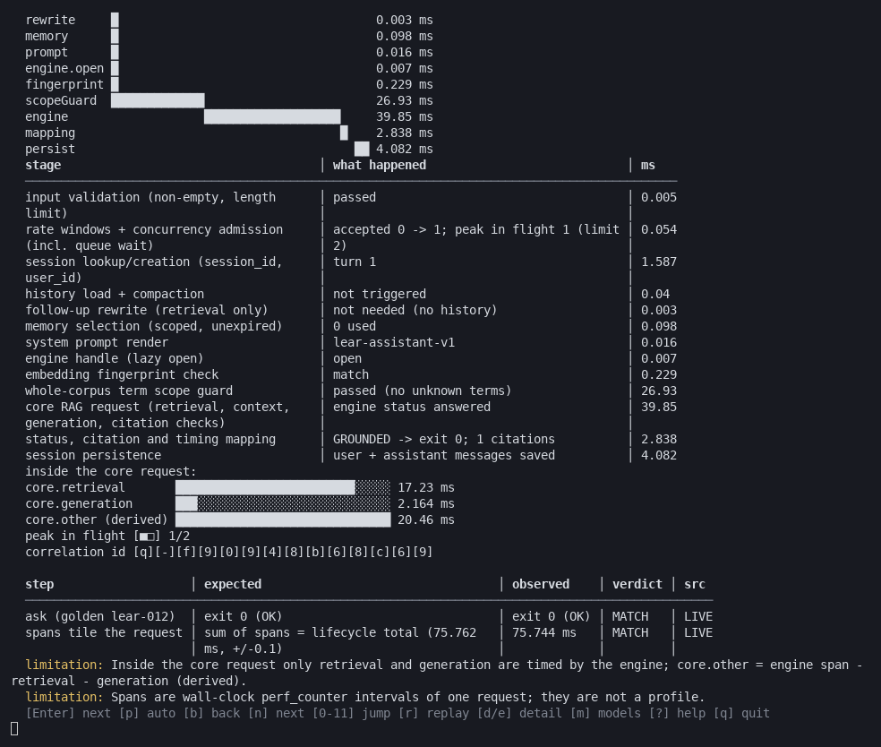

# `lear demo` terminal video

| File | What it is | Size |
|---|---|---|
| [`lear_demo_terminal.mp4`](lear_demo_terminal.mp4?raw=true) | H.264 MP4 (yuv420p), 984×834, 10 fps, 2 min 14 s | 4.3 MB |
| [`lear_demo_terminal.cast`](lear_demo_terminal.cast?raw=true) | The same session as an asciicast v2 recording (plays in `asciinema play`, keeps the real text and timing) | 134 KB |
| [`lear_demo_poster.png`](lear_demo_poster.png) | One frame at 64 s (S04 request lifecycle) | 112 KB |

**One-click download (this branch):**
[MP4](https://github.com/aviunion1348-cloud/rag-formation/raw/arena/227b3998-rag-formation/docs/lear_agent/demo_video/lear_demo_terminal.mp4) ·
[cast](https://github.com/aviunion1348-cloud/rag-formation/raw/arena/227b3998-rag-formation/docs/lear_agent/demo_video/lear_demo_terminal.cast) ·
[whole project ZIP](https://github.com/aviunion1348-cloud/rag-formation/archive/refs/heads/arena/227b3998-rag-formation.zip)



## What the video shows

1. **`python3 -m ragformation lear demo live --source ../lear-backend`** on the
   default (Ollama) backend. The sandbox has no Ollama, so live mode stops at the
   model gate: S02 and S03 are `BLOCKED`, `LIVE MODE STOPPED AT THE DEPENDENCY
   GATE` offers replay, and the exit code is **6**. No answer is produced.
2. **`python3 -m ragformation lear --backend baseline demo director --source
   ../lear-backend`**: the offline baseline pipeline (hashing embedder,
   extractive generator) run for real in a scratch directory, labelled
   `NOT QUALIFYING`. The director is navigated with real key presses (`?` for
   help, then `Enter` per scene) through S00–S11. Exit code **0**.

Every scene's numbers are measured during the recording, at rag-formation commit
`954c8d624515` (clean tree, shown in S00) against the Lear source pin
`60cf9abf` (the docs rebuild in S01 is byte-identical, 10/10). The live
latencies are pipeline-only timings from a 2-vCPU sandbox, not model latency.

## How it was made (reproducible)

```bash
# 1. record a real pseudo-terminal session (stdlib only) -> asciicast v2
python3 scripts/record_demo_video.py --source ../lear-backend \
    --out docs/lear_agent/demo_video/lear_demo_terminal.cast        # exits 0 only if live=6 and director=0

# 2. render the recording to MP4 (optional tooling, NOT a project dependency)
python3 -m venv /tmp/vidvenv && /tmp/vidvenv/bin/pip install pyte Pillow imageio-ffmpeg
/tmp/vidvenv/bin/python scripts/render_demo_video.py \
    docs/lear_agent/demo_video/lear_demo_terminal.cast docs/lear_agent/demo_video/lear_demo_terminal.mp4 \
    --poster docs/lear_agent/demo_video/lear_demo_poster.png --poster-at 64
```

- **What is real and what the recorder adds.** Everything after each command
  line is the process's own output, read from a pseudo-terminal
  (`TERM=xterm-256color`, 120×45) with its real timing. Key presses are written
  into the same terminal. Only the shell prompt, the typed command lines and the
  `echo $?` lines come from the recorder, which has no shell; the exit codes it
  prints are the real ones.
- **Rendering.** `pyte` emulates the terminal, Pillow draws each cell in DejaVu
  Sans Mono, and the ffmpeg binary from `imageio-ffmpeg` encodes H.264 at CRF 28.
  Rendering is deterministic: the same `.cast` gives a byte-identical MP4.
- **No media dependencies in the product.** `pyte`, Pillow and `imageio-ffmpeg`
  are used only by `scripts/render_demo_video.py`. They are not in
  `pyproject.toml`, and the demo runs without them.

| File | sha256 |
|---|---|
| `lear_demo_terminal.mp4` | `a8fda38e5bfce15242109b2c01ce8315773bc9b0e2aa62d16d44cecdd265b823` |
| `lear_demo_terminal.cast` | `bc4558f9e59e5cc5e09adfa3b166b4b620a72f713d852dc4bac58d3b50dd28d3` |
| `lear_demo_poster.png` | `631b647cde92cf697938192a0002ed39bd998cfd0162c64cff60f99aca65b389` |

## What the video is not

- **Not a qualifying model run.** No local Ollama model ran. There is no TTFT,
  ITL, tokens/s or judge score anywhere in it, and S11 says
  `OVERALL: BLOCKED — LOCAL OLLAMA MODEL QUALIFICATION NOT COMPLETED IN THE
  RECORDED ENVIRONMENT.`
- **Not edited.** There are no cuts, overlays or sped-up sections. Scenes longer
  than 45 rows scroll as they do in a real terminal. Pause the video, or play the
  `.cast` file, to read them.
